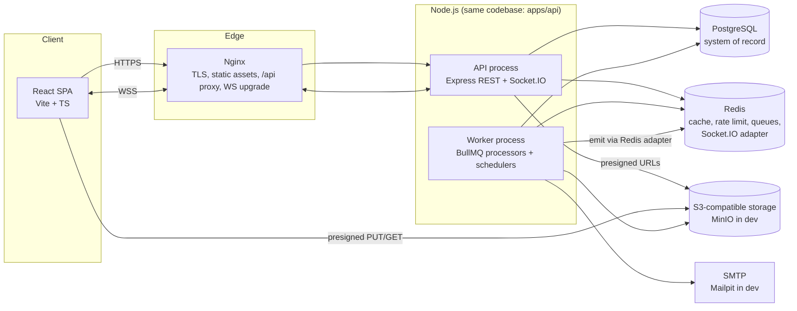
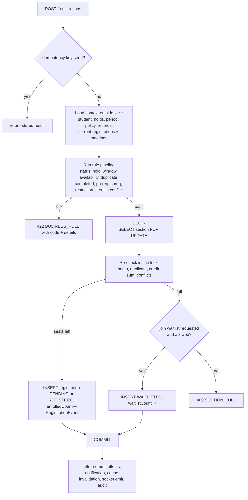

# Architecture

> Status: **design (Phase 0)**. Nothing here is implemented yet; [DEVELOPMENT_ROADMAP.md](DEVELOPMENT_ROADMAP.md) tracks what has been built.

## 1. System architecture



**Modular monolith.** One TypeScript codebase for the backend with two entry points:

- `server.ts`: HTTP API and Socket.IO gateway. Stateless; horizontally scalable.
- `worker.ts`: BullMQ workers and repeatable jobs (scheduled announcements, waitlist sweeper, purge jobs, exports, imports, email). Scaled independently.

Both share the same modules, so the business logic lives in exactly one place. Workers emit Socket.IO events through `@socket.io/redis-emitter`.

## 2. Repository layout (npm workspaces monorepo)

```
/
├── apps/
│   ├── api/                 Express API + worker (two entry points)
│   └── web/                 React SPA
├── packages/
│   └── shared/              Zod schemas, enums, permission keys, error codes, DTO types
├── docker/                  Dockerfiles, nginx.conf
├── docker-compose.yml       postgres, redis, minio, mailpit (+ api, worker, web in prod profile)
├── docs/
└── package.json             workspaces, root scripts
```

**Why npm workspaces:** npm is already installed (pnpm is not). Workspaces are enough for three packages; Turborepo/Nx would add no real value at this size (ADR-002).

`packages/shared` is the contract between front and back. Request/response Zod schemas are defined once, used for API validation, for OpenAPI generation, and for frontend form validation and typing.

## 3. Backend architecture (`apps/api`)

```
src/
├── app.ts                   Express app assembly (middleware order, routers, error handler)
├── server.ts                HTTP + Socket.IO bootstrap, graceful shutdown
├── worker.ts                BullMQ workers bootstrap
├── config/                  env schema (Zod), config object, logger
├── common/
│   ├── middleware/          requestId, httpLogger, authenticate, rateLimit, validate, idempotency, errorHandler
│   ├── guards/              requirePermission(), scope resolvers, ownership checks
│   ├── exceptions/          AppError + typed subclasses (NotFound, Forbidden, Conflict, BusinessRule)
│   ├── validators/          shared Zod helpers (pagination, sort, id)
│   ├── utils/               pagination, sorting, time, crypto, csv/xlsx
│   ├── constants/
│   └── types/
├── modules/<module>/
│   ├── <module>.routes.ts       router: path → middleware chain → controller
│   ├── <module>.controller.ts   HTTP adapter only: parse validated input, call service, shape response
│   ├── <module>.service.ts      business logic, transactions, authorization of resource scope
│   ├── <module>.repository.ts   Prisma queries (only where queries are non-trivial or reused)
│   ├── <module>.schemas.ts      re-exports/extends shared Zod schemas
│   ├── <module>.mapper.ts       entity → role-specific DTO
│   ├── <module>.events.ts       domain events emitted (optional)
│   └── <module>.jobs.ts         queue producers/processors (optional)
├── infrastructure/
│   ├── database/            Prisma client singleton, transaction helper, prisma/ (schema, migrations, seed)
│   ├── redis/               ioredis clients (cache, queue, pubsub), cache helper
│   ├── queues/              queue definitions, default job options, worker factory
│   ├── storage/             StorageService interface; S3 (MinIO) implementation; local-fs implementation for tests
│   ├── email/               mailer + templates
│   └── sockets/             Socket.IO server, auth handshake, rooms, emitter
└── tests/
```

Modules listed in the brief map 1:1 to `modules/`. Thin modules (e.g. `university`, `campuses`) can have a service only.

### 3.1 Request pipeline

```
helmet → cors (allow-list) → requestId → pino-http (redacted) → json(1mb) → cookieParser
  → rateLimit (global, per IP) → router
      → authenticate (JWT verify, session active check)
      → requirePermission('course:update')
      → validate({ params, query, body })
      → controller → service (scope check + business rules + transaction)
  → notFound → errorHandler (AppError → envelope; unknown → 500 without internals)
```

### 3.2 Layer rules

- Controllers never touch Prisma. Services never touch `req`/`res`.
- Services receive an `ActorContext` (`userId`, `sessionId`, `permissions`, `scopes`, `ip`, `userAgent`, `requestId`) so authorization and auditing do not depend on Express.
- Cross-module calls go through the other module's service interface, not its repository.
- Side effects (notifications, emails, cache invalidation, socket emits) are triggered **after commit**: services collect them in a `TransactionEffects` list that is flushed after the transaction resolves. This avoids notifying about rolled-back changes (ADR-006).

### 3.3 Domain events (in-process)

A small typed event bus (`EventEmitter`-based) for decoupling, e.g. `registration.dropped` → waitlist module enqueues promotion; notifications module creates a notification. Durable work always goes through BullMQ; the bus only enqueues.

## 4. Frontend architecture (`apps/web`)

```
src/
├── app/
│   ├── router/          route tree (lazy per portal), route metadata (required permission)
│   ├── providers/       QueryClientProvider, ThemeProvider, SocketProvider, Toaster
│   ├── layouts/         AuthLayout, PortalLayout (sidebar + header + breadcrumbs)
│   └── guards/          RequireAuth, RequirePermission, RedirectByRole
├── components/
│   ├── ui/              shadcn/ui primitives (generated)
│   ├── shared/          PageHeader, EmptyState, ErrorState, StatusBadge, ConfirmDialog, StatCard
│   ├── tables/          DataTable (TanStack Table) with server-side pagination/sort/filter, column visibility, row/bulk actions
│   ├── charts/          Recharts wrappers with consistent theming
│   ├── forms/           RHF + Zod field components
│   └── navigation/      Sidebar, Header, Breadcrumbs, UserMenu, NotificationBell, GlobalSearch
├── features/<domain>/
│   ├── api/             query keys, queryOptions, mutation hooks (TanStack Query)
│   ├── components/
│   ├── pages/
│   └── schemas.ts       (from @ucrams/shared where possible)
├── hooks/  services/ (http client, socket client)  store/ (Zustand)  types/  utils/  pages/ (404, 403, error)
```

- **Server state:** TanStack Query only. Query keys are structured per feature (`['courses', 'list', filters]`). Mutations invalidate precise keys. Socket events invalidate or patch the relevant queries (e.g. `notification:new` → increment unread count).
- **Client state:** Zustand for auth session (access token in memory, user, permissions), UI preferences (sidebar collapsed, theme) and the planner draft. Nothing sensitive goes to `localStorage`; the access token is in memory only.
- **HTTP client:** Axios instance with `withCredentials`; an interceptor attaches the bearer token and, on `401 TOKEN_EXPIRED`, performs a single-flight refresh (one refresh promise shared by concurrent requests) and retries.
- **Routing:** `/login`, `/admin/*`, `/faculty/*`, `/student/*`, plus shared `/profile/security`. Each route declares `requiredPermission`. Guards redirect unauthenticated users to `/login?next=` and unauthorized ones to their home portal with a toast.
- **Design system:** Tailwind tokens (slate/navy foundation, blue accent, semantic success/warning/destructive), Inter for UI text, consistent 4-pt spacing scale, light and dark themes via CSS variables (shadcn convention).
- **Accessibility:** Radix primitives (via shadcn) for focus management; tables have captions and sortable header `aria-sort`; charts have a tabular fallback.

## 5. Database architecture

PostgreSQL 16+, Prisma ORM. Normalized schema (3NF) with deliberate exceptions:

- `CourseSection.enrolledCount` / `waitlistCount`: counters maintained in the same transaction as registration writes, protected by check constraints, reconciled by a sweeper job. Needed for row-lock-based capacity control and cheap catalog reads.
- `AcademicRecord` snapshots course code/title/credits at completion so transcripts remain historically accurate if the course is edited later.

Raw SQL migrations are added alongside Prisma for features Prisma cannot express: partial unique indexes, check constraints, `tsvector` generated columns, GIN/trigram indexes. Details: [DATABASE.md](DATABASE.md).

## 6. Authentication architecture

```mermaid
sequenceDiagram
  participant B as Browser (SPA)
  participant A as API
  participant DB as PostgreSQL
  participant R as Redis
  B->>A: POST /auth/login {email,password}
  A->>R: rate-limit check (ip, identifier)
  A->>DB: load user, verify Argon2id, check lock/status
  A->>DB: create Session + RefreshToken(hash, familyId=sessionId)
  A-->>B: 200 {accessToken, user, permissions} + Set-Cookie rt (HttpOnly, Secure, SameSite=Strict, Path=/api/v1/auth)
  B->>A: API calls with Authorization: Bearer <access>
  A->>A: verify JWT (kid, exp), check session not revoked (Redis cache of revoked sids, 15-min TTL)
  Note over B,A: access token expires (15 min)
  B->>A: POST /auth/refresh (cookie + X-CSRF header)
  A->>DB: find token by hash; if used → reuse detection → revoke session
  A->>DB: mark old used, insert new token (same family)
  A-->>B: new access token + rotated cookie
```

- Access tokens are JWT (ES256 or HS256 via `jose`; ES256 preferred in production with key rotation by `kid`).
- Session revocation must take effect before access-token expiry: revoked session IDs go into a Redis set with TTL = access-token lifetime, checked by `authenticate`. If Redis is down, the middleware falls back to a DB lookup of the session.
- **CSRF:** the refresh cookie is `SameSite=Strict`, path-scoped, and the refresh/logout endpoints additionally require a custom header (`X-CSRF-Token` double-submit value from a non-HttpOnly `csrf` cookie). All other endpoints use bearer tokens, which are not sent automatically by browsers, so they are not CSRF-exposed.
- **MFA-ready:** login returns `{ mfaRequired: true, mfaToken }` (5-min, single purpose) when enabled; `/auth/mfa/verify` completes the session. TOTP implementation is a Should item.

## 7. Authorization architecture

- **Model:** `Permission` (key), `Role` (system or custom), `RolePermission`, `UserRole(userId, roleId, scopeType, scopeId)`.
- **Resolution:** on login/refresh the API computes the effective grants: `{ permission → [GLOBAL] | [SCHOOL ids] | [DEPARTMENT ids] }`. Cached in Redis per user keyed by `permissionsVersion`; invalidated when roles change.
- **Endpoint guard:** `requirePermission('course:update')` verifies the user has the permission in *some* scope (fast fail).
- **Resource scope check:** in the service, `authz.assertInScope(actor, 'course:update', { departmentId })` resolves the resource's department → school chain and checks that a grant covers it. List endpoints call `authz.scopeFilter(actor, perm)`, which returns a Prisma `where` fragment (e.g. `{ departmentId: { in: [...] } }`).
- **Relationship-based rules** (faculty teaching a section, student owning a record) live in policy functions per module: `sectionPolicy.canViewRoster(actor, sectionId)`.
- Faculty and Student roles have permissions such as `roster:read` that are checked *together with* the relationship policy.

Full matrix: [USER_ROLES_AND_PERMISSIONS.md](USER_ROLES_AND_PERMISSIONS.md).

## 8. Registration engine architecture



- **Rule pipeline:** each rule is a pure function `(ctx) => RuleResult` registered in an ordered list. The same pipeline powers the eligibility preview (`GET /registrations/eligibility?sectionId=`), submit, admin override (selected rules disabled), batch planner registration, and waitlist promotion (subset of rules).
- **Locking scope:** one row lock per section; locks on different sections do not contend. Student-level serialization (to make the credit-limit/conflict re-check race-free when one student submits two registrations at once) uses `SELECT … FOR UPDATE` on the `Student` row, taken *before* the section lock. Consistent lock order (student → section, sections by ID ascending in batch) prevents deadlocks.
- **Isolation:** READ COMMITTED plus explicit row locks. Transactions are short (no network calls inside). Serialization errors/deadlocks are retried up to 3 times.
- **Waitlist promotion:** a `waitlist` queue job keyed by `sectionId` (BullMQ job ID deduplication, so concurrent triggers collapse). The processor locks the section, loops while seats are free: takes the next WAITLISTED entry, re-validates, promotes or skips. A repeatable sweeper job (every 5 min) finds sections where `enrolledCount < capacity` and `waitlistCount > 0` and enqueues them, covering missed triggers.
- **Offer expiry:** delayed job per OFFERED registration at `offerExpiresAt`; the sweeper also expires stale offers.

## 9. Redis usage

| Use | Key pattern | TTL / invalidation |
|---|---|---|
| Rate limiting (`rate-limiter-flexible`) | `rl:{bucket}:{key}` | sliding window |
| Login failure counters | `auth:fail:{userId}` | lock duration |
| Revoked session IDs | `auth:revoked:{sid}` | access-token TTL |
| Effective permissions | `authz:{userId}:{permVersion}` | 15 min; versioned key so role change = new key |
| Dashboard aggregates | `dash:{scopeHash}:{filterHash}` | 60 s; tag-invalidated on registration writes |
| Catalog lists (public data) | `catalog:{sessionId}:{queryHash}` | 30 s; seat counts are always read live for section detail |
| Structure lookups (schools/departments/programs) | `org:{entity}:list` | 10 min; invalidated on CRUD |
| Idempotency results | `idem:{userId}:{key}` | 24 h |
| BullMQ | `bull:*` | managed by BullMQ |
| Socket.IO adapter | `socket.io#*` | pub/sub |
| Online presence | `presence:{userId}` | 60 s heartbeat |

Student records, rosters and messages are **not** cached (NFR-PRIV-003). Redis uses separate logical DBs or key prefixes for cache vs queues; cache is `allkeys-lru`-safe, but the queue instance must be `noeviction` (production uses two Redis instances or a single one with `noeviction` and bounded cache TTLs).

## 10. Queue architecture (BullMQ)

| Queue | Jobs | Retry | Notes |
|---|---|---|---|
| `email` | transactional emails | 5×, exponential 30 s | idempotent by `emailLogId` |
| `notifications` | fan-out for announcements and bulk events | 5× | chunked by 500 recipients |
| `announcements` | scheduled publish | 3× | delayed jobs, jobId = announcementId |
| `waitlist` | promote section, expire offer, sweeper | 5× | jobId = `promote:{sectionId}` dedupe |
| `imports` | bulk students/faculty | 1× (manual retry) | per-row results stored in `ImportJob` |
| `exports` | report CSV/XLSX | 3× | file to storage, signed link notification |
| `maintenance` | purge notifications/login history, counter reconcile, expire waitlists at period close | 3× | repeatable cron |

Failed jobs are retained (last 1,000), surfaced on the admin dashboard as system alerts, and logged with job ID and correlation ID. Workers shut down gracefully (finish the current job) on SIGTERM.

## 11. WebSocket architecture

- Socket.IO with the Redis adapter; Nginx forwards upgrade headers; sticky sessions are not required when the transport is WebSocket-only (polling disabled).
- **Handshake auth:** client sends the access token in `auth.token`; the server verifies JWT and session; on token expiry the client reconnects with a fresh token.
- **Rooms:** `user:{id}` (notifications, DMs), `conversation:{id}` (joined on demand after a membership check), `section:{id}` (discussion updates).
- **Events (server → client):** `notification:new`, `message:new`, `message:updated`, `conversation:read`, `typing`, `registration:updated`, `announcement:new`.
- **Client → server:** `conversation:join`, `conversation:leave`, `typing`, `message:read`. Message *sending* goes through REST (validation, rate limit, persistence, single code path); the server then emits. This keeps one write path and makes messages testable via Supertest.

## 12. File storage architecture

- `StorageService` interface: `createUploadUrl`, `headObject`, `getDownloadUrl`, `delete`, `putObject` (server-side generated files).
- Implementations: S3 (AWS SDK v3, works with MinIO/R2/S3) and a local filesystem driver (development and tests) whose presigned URLs are HMAC-signed tokens served by `/api/v1/storage/local/:token`.
- Upload flow: `POST /files/upload-intents {context, contextId, filename, size, mimeType}` → permission + allow-list check → `StoredFile` row `PENDING` + presigned PUT (max size enforced through signed content-length) → client uploads → `POST /files/{id}/complete` → server fetches the first bytes, sniffs magic number (`file-type`), checks size, sets `READY`. Unreferenced `PENDING` files are purged after 24 h.
- Downloads: `GET /files/{id}/download` → policy check by context → 302 to a 5-minute signed GET URL with `Content-Disposition: attachment` for non-image types.

## 13. Deployment architecture

- **Containers:** `api`, `worker`, `web` (Nginx serving the built SPA and proxying `/api` and `/socket.io`), `postgres`, `redis`, `minio`, `mailpit` (dev only).
- **Environments:** development (compose infra + local `npm run dev`), CI (compose services), production (compose or any container orchestrator; managed Postgres/Redis/S3 recommended).
- **Migrations:** `prisma migrate deploy` runs as a one-off release step before new API/worker containers start.
- **Config:** 12-factor env vars validated at boot with Zod; the process exits on invalid config.
- **Health:** `/api/v1/health/live` (process up), `/api/v1/health/ready` (DB + Redis required; storage failure reports `degraded`). Container health checks use them.
- **Backups:** nightly `pg_dump` (compose `backup` service with retention) for simple deployments; WAL archiving/PITR recommended with managed Postgres.
- **Logging/monitoring:** Pino JSON to stdout → collector of choice. Metrics endpoint (`/metrics`, Prometheus format, S) for request latency, queue depth, failed jobs.

## 14. Security architecture

Defence in depth: TLS at the edge → Helmet headers + strict CSP for the SPA → CORS allow-list → rate limiting → authentication → permission guard → scope/relationship policy → Zod validation → Prisma parameterized queries → DTO mappers (output minimization) → audit log. Details and OWASP mapping: [SECURITY.md](SECURITY.md).

## 15. Architecture Decision Records (summary)

| ADR | Decision | Reason |
|---|---|---|
| ADR-001 | Modular monolith with separate worker entry point | Single codebase, simple deploy, independent scaling of background work |
| ADR-002 | npm workspaces monorepo (`apps/api`, `apps/web`, `packages/shared`) | Shared Zod contracts; npm available; no need for heavier tooling |
| ADR-003 | Model the org unit "Faculty/School" as `School` in code; faculty members as `FacultyMember` | Removes the ambiguity of "faculty" meaning both an org unit and a person. The UI label is configurable ("Faculty" or "School") |
| ADR-004 | Opaque refresh tokens (hashed) in HttpOnly cookie + in-memory JWT access tokens | Rotation and reuse detection require server-side state anyway; avoids XSS-readable long-lived tokens |
| ADR-005 | Pessimistic row locks for seat allocation instead of Redis locks | The DB is the source of truth; locks die with the transaction; check constraints provide a hard guarantee; Redis locks would add failure modes without benefit |
| ADR-006 | After-commit side effects | Never notify or emit for rolled-back transactions |
| ADR-007 | "Approved" is an event, not a resting status | A registration approved for a seat *is* registered; a separate APPROVED state adds a transition with no behavioural difference |
| ADR-008 | Prerequisites as AND-of-OR groups | Expresses nearly all real catalog rules without a free-form expression language |
| ADR-009 | `AcademicRecord` as the source for prerequisites/progress/GPA, separate from `CourseRegistration` | Supports transfer credits and exemptions; transcript snapshots immune to catalog edits |
| ADR-010 | Message sending via REST, real-time delivery via Socket.IO | One validated write path; sockets only for push |
| ADR-011 | Zod as single schema source → OpenAPI via `@asteasolutions/zod-to-openapi` | No drift between validation and docs |
| ADR-012 | PostgreSQL full-text + `pg_trgm` for search | Adequate at target scale; no extra search cluster |
| ADR-013 | Native Postgres/Redis supported for development when Docker is unavailable | The current dev machine has PostgreSQL 17 but no Docker/Redis |
