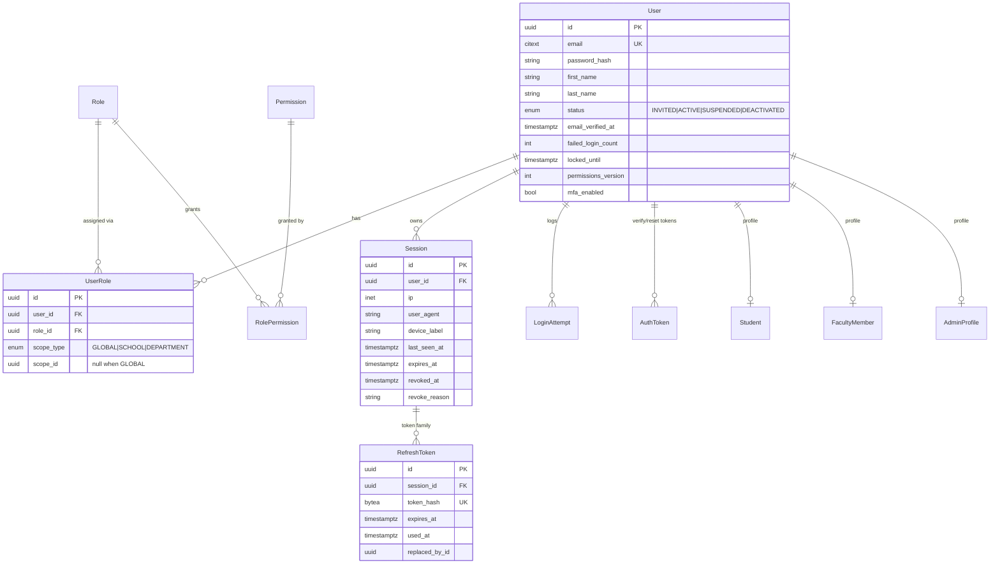
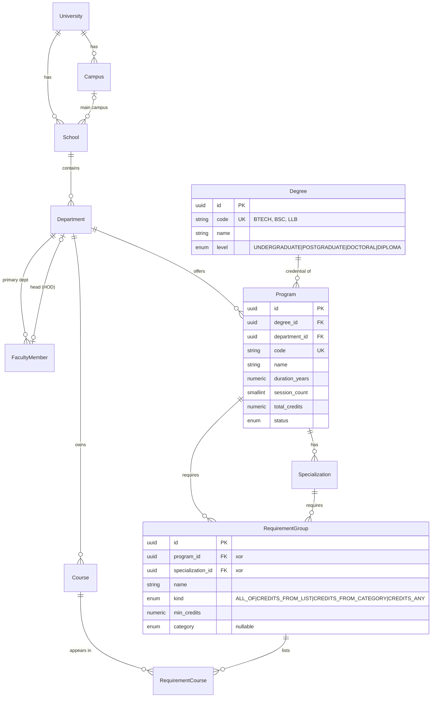
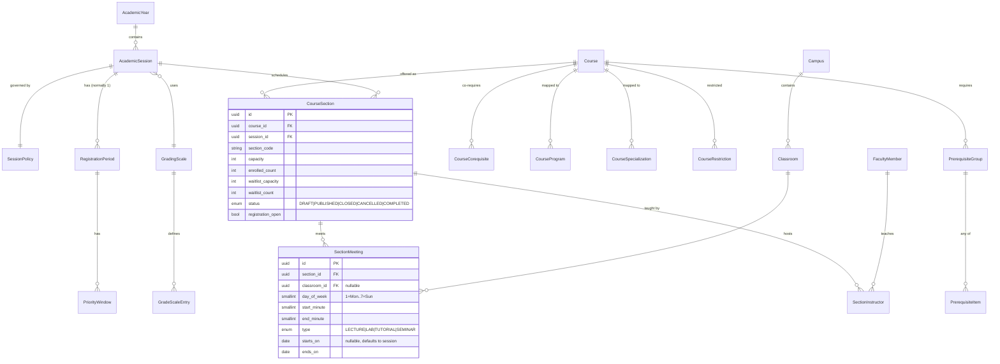
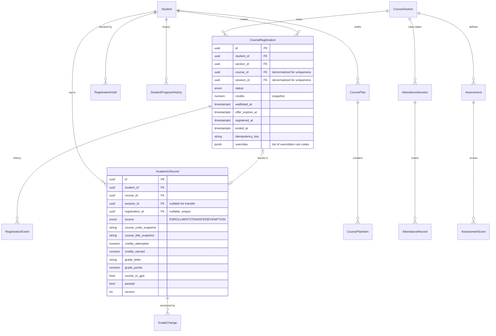
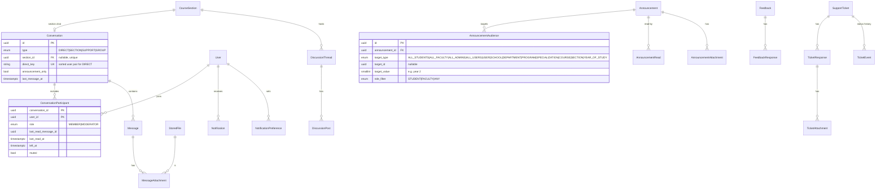
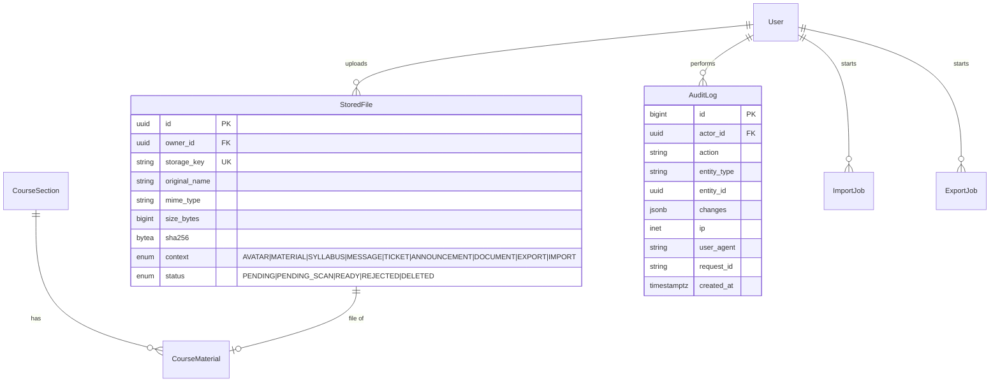

# Database Design

> Status: identity, access and audit tables **implemented (Phase 2)**; structure and calendar tables **implemented (Phase 3)**; everything else is design. Changes during implementation are reflected here.
>
> Phase 7 added `section_materials` (CHECK: file xor link) and `announcements` with `announcement_audiences` (section audiences; more types in Phase 9).
>
> Phase 6 added `course_registrations` (trigger keeps course/session equal to the section; partial unique index on active attempts), `registration_events`, `registration_requests`, `academic_records`, `course_plans`/`course_plan_items` and `notifications`. Connections pin `TimeZone=UTC` so `timestamptz` values do not depend on the server's zone.
>
> Phase 5 added courses (generated `search_vector`), outcomes, assessment components, prerequisite groups/items, corequisites, program/specialization mappings, restrictions, requirement courses, classrooms, sections (with `schedule_override_reason`), meetings and instructors. Meetings have no own date range yet (they span the session).
>
> Phase 4 added students, student contacts, program history, registration holds, faculty members (+ secondary departments), admin profiles, `id_sequences` (generated student/employee numbers), `stored_files`, `import_jobs`/`import_job_rows`, `users.avatar_file_id`, `schools.dean_id` and `departments.head_id`, plus a trigger keeping a student's specialization inside their program.
>
> Phase 3 differences from the design below: `requirement_courses` with courses (Phase 5); `registration_periods.session_id` is unique (one period per session); campuses have no university FK (single tenant); `calendar_events` is not yet created.

## 1. Conventions

- PostgreSQL 16+, Prisma ORM. Models are `PascalCase`, mapped to `snake_case` tables/columns with `@@map`/`@map`.
- Primary keys: `uuid` (v7, generated in the app for index locality) named `id`.
- Every table has `created_at`; mutable tables have `updated_at`. Timestamps are `timestamptz` (UTC).
- Human-facing identifiers (student number, ticket number, course code) are separate unique columns, never the PK.
- Status columns are Postgres enums (Prisma `enum`).
- Deletion: `RESTRICT` by default. `CASCADE` only for pure link/child rows without history (marked **[C]** below).
- Soft deactivation via `status` (and `deactivated_at` where useful) for academic entities.
- Monetary fields: none in scope.
- Credits: `numeric(4,1)` with `CHECK (credits >= 0 AND credits <= 60)`.
- Times of day: `smallint` minutes since midnight (`start_minute`, `end_minute`) with `CHECK (0 <= start < end <= 1440)`. Simple, time-zone free, cheap overlap math.

## 2. Entity Relationship Diagrams

The ERD is split by domain for readability. Crow's-foot notation (Mermaid).

### 2.1 Identity and access



### 2.2 University structure



### 2.3 Calendar, catalog and sections



### 2.4 Registration, records, academics



### 2.5 Communication



### 2.6 Platform



## 3. Table catalogue

`[C]` = rows cascade-delete with the parent. Everything else restricts.

### 3.1 Identity and access
| Table | Purpose | Key constraints / indexes |
|---|---|---|
| `users` | Login identity for all roles | `email` unique (citext); index `status` |
| `roles` | System and custom roles | `key` unique; `is_system`; `scope_mode` (`ORGANIZATIONAL`/`RELATIONSHIP`, ADR-014) |
| `permissions` | Permission catalogue (`resource:action`) | `key` unique |
| `role_permissions` [C] | Role → permission | PK (`role_id`, `permission_id`) |
| `user_roles` | Scoped role assignment | partial unique (`user_id`, `role_id`) WHERE `scope_id IS NULL` and partial unique (`user_id`, `role_id`, `scope_type`, `scope_id`) WHERE `scope_id IS NOT NULL` (ADR-015); CHECK `scope_type='GLOBAL' = (scope_id IS NULL)`; `scope_id` is polymorphic (school or department), validated in the service |
| `sessions` | Device sessions (device label, IP, remember-me, sliding expiry) | index (`user_id`, `revoked_at`); partial index (`user_id`) WHERE `revoked_at IS NULL` |
| `refresh_tokens` [C] | Hashed rotating tokens per session | `token_hash` unique; index `session_id` |
| `auth_tokens` | Hashed single-use tokens: `EMAIL_VERIFY`, `PASSWORD_RESET`, `MFA_CHALLENGE` | `token_hash` unique; index (`user_id`, `type`) |
| `login_attempts` | Login history (outcome, IP, user agent; attempts for unknown emails are stored without the email) | index (`user_id`, `created_at desc`), (`ip`, `created_at`) |
| `mfa_recovery_codes` [C] | Hashed recovery codes | — (planned with MFA; not yet created) |

### 3.2 Profiles
| Table | Purpose | Key constraints |
|---|---|---|
| `students` | 1:1 with user | `user_id` unique; `student_number` unique; FK `program_id`, `specialization_id` (CHECK via trigger/service that the specialization belongs to the program); `admission_session_id`; `year_of_study` CHECK 1..10; `status` enum; `cohort` string; index (`program_id`, `status`), (`department_id` derived via program; not stored) |
| `student_program_history` | Program/specialization changes | index `student_id` |
| `faculty_members` | 1:1 with user | `employee_number` unique; FK `department_id`; `designation` enum; `max_load_credits` |
| `faculty_secondary_departments` [C] | Joint appointments | PK (`faculty_member_id`, `department_id`) |
| `admin_profiles` | 1:1 with user for staff details | `employee_number` unique |
| `registration_holds` | Holds blocking registration | index (`student_id`) where `released_at IS NULL` |
| `student_contacts` | Address, emergency contact (sensitive, separated for access control) | `student_id` unique |

### 3.3 Structure
| Table | Purpose | Key constraints |
|---|---|---|
| `universities` | Single row (A-01) | — |
| `campuses` | Campus locations | `code` unique |
| `schools` | Faculty/School org units | `code` unique; FK `dean_id` → faculty_members (nullable) |
| `departments` | Departments | `code` unique; FK `school_id`, `head_id` (nullable) |
| `degrees` | Credential types | `code` unique |
| `programs` | Degree offering by department | `code` unique; FK `degree_id`, `department_id`; CHECK `total_credits > 0` |
| `specializations` | Program tracks | unique (`program_id`, `code`) |
| `requirement_groups` | Program/specialization requirement blocks | CHECK exactly one of (`program_id`, `specialization_id`) non-null |
| `requirement_courses` [C] | Courses in a requirement group | PK (`group_id`, `course_id`) |

### 3.4 Calendar
| Table | Purpose | Key constraints |
|---|---|---|
| `academic_years` | e.g. 2026–2027 | `label` unique; CHECK `start_date < end_date` |
| `academic_sessions` | Terms/semesters | unique (`academic_year_id`, `code`); CHECK dates; FK `grading_scale_id`; partial unique index on `type` where `is_current` |
| `session_policies` | Registration policy per session | `session_id` unique; `min_credits`, `max_credits`, `max_credits_with_override`, `approval_mode` enum (`NONE`, `ALL`, `CROSS_DEPARTMENT`, `LATE_ONLY`), `waitlist_enabled`, `waitlist_promotion_mode` (`AUTO_ENROLL`, `OFFER`), `offer_window_hours`, `count_waitlist_in_credits`, `allow_in_progress_prereqs`, `withdrawal_requires_approval` |
| `registration_periods` | Windows | FK `session_id`; `opens_at`, `closes_at`, `add_drop_deadline`, `withdrawal_deadline`, `late_closes_at`; CHECK ordering |
| `priority_windows` [C] | Earlier opening for cohorts | FK period; `opens_at`; criteria columns (`program_id`, `year_of_study`, `cohort`) all nullable, at least one non-null |
| `grading_scales` | Named scales | `name` unique |
| `grade_scale_entries` [C] | Letter rows | unique (`scale_id`, `letter`); `min_percent`, `grade_points` nullable, `is_passing`, `counts_in_gpa`, `counts_as_attempt` |
| `calendar_events` | Holidays, exam weeks (S) | index (`session_id`, `date`) |

### 3.5 Catalog and sections
| Table | Purpose | Key constraints |
|---|---|---|
| `courses` | Catalog entries | `code` unique; FK `department_id`, `coordinator_id`; `credits` CHECK; `category` enum; `level` smallint; `is_repeatable`; `search_vector` generated tsvector + GIN; trigram GIN on `code`, `title` |
| `course_outcomes` [C] | Ordered learning outcomes | unique (`course_id`, `position`) |
| `course_assessment_components` [C] | Informational structure (name, weight) | CHECK weight 0..100 |
| `prerequisite_groups` [C] | AND-groups | index `course_id` |
| `prerequisite_items` [C] | OR-items in a group | unique (`group_id`, `required_course_id`); `min_grade_letter` nullable |
| `course_corequisites` [C] | Coreqs | PK (`course_id`, `corequisite_id`); CHECK `course_id <> corequisite_id` |
| `course_programs` [C] | Course ↔ program mapping | PK (`course_id`, `program_id`); `mapping_type` (`CORE`, `ELECTIVE`) |
| `course_specializations` [C] | Course ↔ specialization | PK (`course_id`, `specialization_id`) |
| `course_restrictions` [C] | Include/exclude rules | FK course *or* section (CHECK one); `mode`, `target_type`, `target_id`/`target_value` |
| `classrooms` | Rooms | unique (`campus_id`, `building`, `room_number`); `capacity` CHECK > 0; `equipment text[]` |
| `course_sections` | Offerings | unique (`course_id`, `session_id`, `section_code`); CHECK `0 <= enrolled_count <= capacity`; CHECK `0 <= waitlist_count`; index (`session_id`, `status`), (`course_id`, `session_id`) |
| `section_meetings` [C] | Weekly meetings | CHECK minutes; index (`classroom_id`, `day_of_week`); classroom overlap enforced in service (exclusion constraint with `btree_gist` considered, S) |
| `section_instructors` | Assignments | PK (`section_id`, `faculty_member_id`); `role` (`PRIMARY`, `SECONDARY`, `TA`); partial unique: one PRIMARY per section; index `faculty_member_id` |

### 3.6 Registration and records
| Table | Purpose | Key constraints |
|---|---|---|
| `course_registrations` | Enrollment attempts | **partial unique** (`student_id`, `course_id`, `session_id`) WHERE `status IN ('PENDING','REGISTERED','OFFERED','WAITLISTED')`; unique (`student_id`, `idempotency_key`) where not null; index (`section_id`, `status`), (`student_id`, `session_id`, `status`), (`section_id`, `status`, `waitlisted_at`, `id`) for waitlist order |
| `registration_events` | Append-only history | index (`registration_id`, `created_at`) |
| `registration_requests` | Pending approval requests (late add, withdrawal requiring approval, overrides requested by students) | index (`status`, `created_at`) |
| `academic_records` | Course outcomes | unique (`registration_id`) where not null; index (`student_id`, `course_id`); index (`student_id`, `session_id`) |
| `grade_changes` | Versioned grade history | index `academic_record_id` |
| `course_plans` / `course_plan_items` [C] | Planner | unique (`student_id`, `session_id`, `name`); item unique (`plan_id`, `course_id`) |

### 3.7 Academics (foundational)
| Table | Purpose |
|---|---|
| `attendance_sessions` | Class dates per section (unique `section_id`, `date`, `meeting_id`) |
| `attendance_records` [C] | Status per student per attendance session (PK `attendance_session_id`, `student_id`) |
| `assessments` | Assessment components per section (`type`, `weight`, `max_score`, `due_at`, `published_at`) |
| `assessment_scores` | Score per student (unique `assessment_id`, `student_id`); CHECK `score >= 0` |
| `final_grade_submissions` | Section-level grade submission workflow (`DRAFT`, `SUBMITTED`, `APPROVED`, `POSTED`) |

### 3.8 Communication
| Table | Purpose | Key constraints |
|---|---|---|
| `conversations` | Threads | `direct_key` unique (DIRECT); `section_id` unique (SECTION) |
| `conversation_participants` | Membership, read pointer | PK (`conversation_id`, `user_id`); index (`user_id`, `left_at`) |
| `messages` | Messages | index (`conversation_id`, `created_at desc`); `search_vector` GIN; `deleted_at` |
| `message_attachments` [C] | Link to files | PK (`message_id`, `file_id`) |
| `discussion_threads` / `discussion_posts` | Section Q&A | index (`section_id`, `last_activity_at`) |
| `announcements` | Announcements | index (`status`, `publish_at`), (`expires_at`) |
| `announcement_audiences` [C] | Targets | index (`target_type`, `target_id`) |
| `announcement_reads` [C] | Read tracking | PK (`announcement_id`, `user_id`) |
| `notifications` | In-app notifications | index (`user_id`, `read_at`, `created_at desc`) |
| `notification_preferences` [C] | Per-category/channel | PK (`user_id`, `category`, `channel`) |
| `email_logs` | Outbound email attempts | index (`status`, `created_at`) |
| `feedback` / `feedback_responses` | Feedback | index (`status`, `priority`), (`submitted_by_id`) |
| `support_tickets` / `ticket_responses` / `ticket_events` / `ticket_attachments` | Tickets | `ticket_number` unique (sequence-backed); index (`status`, `assignee_id`), (`owner_id`) |

### 3.9 Platform
| Table | Purpose |
|---|---|
| `stored_files` | File metadata (object storage key) |
| `course_materials` | Section materials (folder, title, file or URL, `published_at`) |
| `documents` | General documents attached to a user/entity (e.g. faculty CV) with visibility |
| `audit_logs` | Append-only audit (bigint identity PK; monthly partitioning planned once volume requires) |
| `import_jobs` / `import_job_rows` | Bulk import state and per-row results |
| `export_jobs` | Report export state |
| `system_settings` | Key/value typed settings (`key` unique, `value jsonb`, validated by a Zod schema per key in code) |
| `idempotency_keys` | Fallback store if Redis is unavailable (S) |

## 4. Enumerations (initial)

- `UserStatus`: INVITED, ACTIVE, SUSPENDED, DEACTIVATED
- `StudentStatus`: ACTIVE, ON_LEAVE, SUSPENDED, GRADUATED, WITHDRAWN, DISMISSED
- `FacultyDesignation`: PROFESSOR, ASSOCIATE_PROFESSOR, ASSISTANT_PROFESSOR, LECTURER, SENIOR_LECTURER, ADJUNCT, VISITING, EMERITUS
- `EntityStatus`: ACTIVE, INACTIVE, ARCHIVED (schools, departments, programs, specializations, classrooms)
- `CourseStatus`: DRAFT, ACTIVE, INACTIVE, ARCHIVED
- `CourseCategory`: CORE, ELECTIVE, GENERAL_EDUCATION, LABORATORY, SEMINAR, RESEARCH, PROJECT, INTERNSHIP, PRACTICAL
- `SessionType`: FALL, SPRING, SUMMER, WINTER, TRIMESTER_1, TRIMESTER_2, TRIMESTER_3, CUSTOM
- `SessionStatus`: PLANNED, ACTIVE, COMPLETED, ARCHIVED
- `SectionStatus`: DRAFT, PUBLISHED, CLOSED, CANCELLED, COMPLETED
- `RegistrationStatus`: PENDING, REGISTERED, WAITLISTED, OFFERED, DROPPED, WITHDRAWN, REJECTED, CANCELLED, EXPIRED, COMPLETED
- `HoldType`: FINANCIAL, ACADEMIC, DISCIPLINARY, ADMINISTRATIVE, DOCUMENTATION
- `FeedbackStatus`: OPEN, UNDER_REVIEW, IN_PROGRESS, RESOLVED, CLOSED
- `TicketStatus`: OPEN, IN_PROGRESS, WAITING_ON_USER, RESOLVED, CLOSED
- `TicketCategory`: COURSE_REGISTRATION, ACADEMIC, FACULTY, TECHNICAL, ACCOUNT, DEPARTMENT, OTHER
- `Priority`: LOW, NORMAL, HIGH, URGENT
- `NotificationCategory`: REGISTRATION, WAITLIST, ANNOUNCEMENT, MESSAGE, TICKET, FEEDBACK, SCHEDULE, SYSTEM

## 5. Critical constraints (raw SQL migrations)

```sql
-- Capacity invariant
ALTER TABLE course_sections
  ADD CONSTRAINT chk_section_capacity CHECK (enrolled_count >= 0 AND enrolled_count <= capacity),
  ADD CONSTRAINT chk_waitlist_count CHECK (waitlist_count >= 0);

-- One active attempt per course per session per student
CREATE UNIQUE INDEX uq_active_registration
  ON course_registrations (student_id, course_id, session_id)
  WHERE status IN ('PENDING','REGISTERED','OFFERED','WAITLISTED');

-- One primary instructor per section
CREATE UNIQUE INDEX uq_primary_instructor
  ON section_instructors (section_id) WHERE role = 'PRIMARY';

-- Meeting time sanity
ALTER TABLE section_meetings
  ADD CONSTRAINT chk_meeting_time CHECK (start_minute >= 0 AND start_minute < end_minute AND end_minute <= 1440),
  ADD CONSTRAINT chk_meeting_day CHECK (day_of_week BETWEEN 1 AND 7);

-- Search
CREATE EXTENSION IF NOT EXISTS pg_trgm;
CREATE EXTENSION IF NOT EXISTS citext;
ALTER TABLE courses ADD COLUMN search_vector tsvector
  GENERATED ALWAYS AS (
    setweight(to_tsvector('simple', coalesce(code,'')), 'A') ||
    setweight(to_tsvector('english', coalesce(title,'')), 'A') ||
    setweight(to_tsvector('english', coalesce(description,'')), 'C')
  ) STORED;
CREATE INDEX ix_courses_search ON courses USING GIN (search_vector);
CREATE INDEX ix_courses_title_trgm ON courses USING GIN (title gin_trgm_ops);
CREATE INDEX ix_courses_code_trgm ON courses USING GIN (code gin_trgm_ops);
```

Prisma doesn't model these, so they are added via `prisma migrate dev --create-only` and edited by hand. The `search_vector` column is declared in Prisma as `Unsupported("tsvector")?`.

## 6. Transaction strategies

| Operation | Strategy |
|---|---|
| Register / waitlist | `prisma.$transaction(async tx => …)` READ COMMITTED; `SELECT … FROM students WHERE id=$1 FOR UPDATE` then `SELECT … FROM course_sections WHERE id=$1 FOR UPDATE` (raw query via `tx.$queryRaw`); re-check; insert; `UPDATE course_sections SET enrolled_count = enrolled_count + 1`. Retry on `40001`/`40P01` (max 3, jittered). |
| Batch register (planner) | One transaction **per item** (independent results), items ordered so corequisite pairs share one transaction; sections locked in ascending ID order |
| Drop / withdraw | Lock student → section; update status; decrement counter; insert event; after commit enqueue `promote:{sectionId}` |
| Waitlist promotion | Lock section; loop over waitlist in order (`FOR UPDATE SKIP LOCKED` on registration rows); each promotion locks the candidate student row (`NOWAIT`; on failure skip and requeue) |
| Section cancel | Lock section; bulk update registrations; set counters to 0; insert events in bulk; after commit enqueue notifications |
| Capacity change | Lock section; validate `new >= enrolled_count`; update; after commit enqueue promotion if increased |
| Grade posting | Per-section transaction creating/updating academic records and registration status; grade changes append `grade_changes` |
| Bulk import | Row batches of 200 per transaction; per-row savepoints so a bad row doesn't abort the batch |
| Auth refresh | Transaction: select token `FOR UPDATE`, mark used, insert successor |

Counters are reconciled hourly by a maintenance job: `enrolled_count = count(seat-holding)` per section (logs and alerts on drift, which should never happen).

## 7. Index strategy (hot paths)

| Query | Index |
|---|---|
| Catalog by session with filters | `course_sections (session_id, status)`, `courses (department_id, status)`, FTS GIN |
| Student's registrations in a session | `course_registrations (student_id, session_id, status)` |
| Section roster | `course_registrations (section_id, status)` |
| Waitlist order | `course_registrations (section_id, status, waitlisted_at, id)` |
| Faculty's sections | `section_instructors (faculty_member_id)` |
| Notifications inbox | `notifications (user_id, read_at, created_at DESC)` |
| Conversation messages | `messages (conversation_id, created_at DESC)` |
| Audit filter | `audit_logs (entity_type, entity_id)`, `(actor_id, created_at)`, BRIN on `created_at` |
| Login history | `login_attempts (user_id, created_at DESC)` |

## 8. Data integrity rules not expressible as constraints (enforced in services + tests)

- Specialization must belong to the student's program.
- Prerequisite graph must be acyclic (DFS check on write).
- Requirement group course lists may only include `ACTIVE`/`INACTIVE` courses (not `DRAFT`).
- Section meetings must lie within session dates.
- Classroom overlap within a session (service check; `btree_gist` exclusion constraint planned).
- `course_registrations.course_id/session_id` must equal the section's (set by service, never by client; verified by a trigger in Phase 6).

## 9. Migration strategy

- Development: `prisma migrate dev`. Each migration is reviewed. Raw SQL is appended to the generated migration file when needed.
- Production: `prisma migrate deploy` in a release step; migrations must be backward compatible with the previous app version (expand → migrate data → contract over two releases).
- Never edit an applied migration; add a new one.
- Seeds: `prisma db seed` → `seed/index.ts` with idempotent upserts keyed on natural keys (codes, emails). Environment guard: the dev-credential seed refuses to run when `NODE_ENV=production`; production uses a separate bootstrap command that creates one super admin from env-provided credentials and forces a password change.
- Backups: see ARCHITECTURE.md §13.

## 10. Seed data plan (Phase 1 onward)

- 1 university, 2 campuses.
- 9 schools: Engineering, Science, Law, Arts & Humanities, Social Sciences, Business & Management, Medicine & Health Sciences, Education, Architecture & Design.
- Engineering departments (12): Software Eng., Computer Science, Electrical, Mechanical, Electronics, Electronics & Communication, Civil, Chemical, Aerospace, Biomedical, AI & Data Science, Robotics & Automation. Plus at least one department in each other school (e.g. Biology, Chemistry, Physics, Mathematics in Science; Law; English, History, Philosophy, Fine Arts, Linguistics in Arts; Economics, Political Science, Sociology in Social Sciences; Management, Commerce in Business; Medicine in Medicine; Education; Architecture).
- Degrees: B.Tech, B.E., B.Sc., B.A., LL.B., BBA, B.Com, B.Arch, MBBS, B.Ed., M.Sc., M.Tech, M.A., MBA, LL.M., Ph.D.
- Programs: one per relevant department/degree, including B.Sc. Biology (5 specializations: Molecular Biology, Microbiology, Genetics & Genomics, Biotechnology, Ecology & Environmental Biology), B.A. (English Literature, History, Philosophy, Fine Arts, Linguistics, + Performing Arts, Creative Writing, Cultural Studies, Music, Political Science), LL.B. (Criminal, Corporate, Constitutional, International, IP, Civil, Environmental, Human Rights Law).
- 2 academic years, 4 sessions (one completed, one active, one planned), registration periods, policies, one example grading scale labelled "Example 10-point scale" and one "Example 4.0 letter scale".
- ~250 courses with prerequisites, ~400 sections in the active session with meetings and classrooms, ~120 faculty, ~2,000 students, historical academic records for the completed session, ~8,000 registrations, waitlists, announcements, tickets, feedback.
- Dev accounts for each role (documented in README; passwords only for development).
